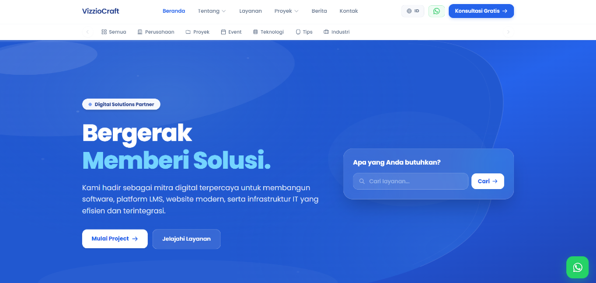

# VizzioCraft (vizzioV1)

Repositori resmi: [Adiwijaya11/vizzioV1](https://github.com/Adiwijaya11/vizzioV1)

Repositori **vizzioV1** adalah sistem web company profile dan panel manajemen operasional untuk **VizzioCraft**. Aplikasi ini dibangun menggunakan Laravel, Tailwind CSS, MySQL, dan Vite.



---

## Modul dan Fitur

### 1. Web Publik
- Beranda: Hero section dinamis, pencarian layanan, dan CTA.
- Layanan: Katalog layanan digital dan rincian paket.
- Portofolio: Daftar proyek aktif dan selesai dengan filter kategori.
- Berita: Publikasi artikel dan wawasan teknologi.
- Tentang Kami: Profil perusahaan, metodologi, dan tim.
- Kontak: Form kontak terhubung ke database dan tombol WhatsApp.

### 2. Panel Admin (Role: Admin)
- Dashboard Overview: Statistik real-time, tren kunjungan 7 hari, dan ringkasan aktivitas.
- Analitik Pengunjung: Data log pengunjung, peramban, sistem operasi, dan rujukan.
- Laporan Traffic: Analisis funnel dan konversi lead.
- Manajemen Konten: CRUD Berita, Portofolio Proyek, Layanan Digital, Galeri Media, Tim, dan Testimonial.
- Interaksi: Manajemen pesan masuk kontak, CRM penawaran (leads), dan notifikasi sistem.
- Pengaturan: Profil perusahaan, konten halaman statis, konfigurasi SEO dan meta tag, serta banner hero.

### 3. Khusus Super Admin (Role: Super Admin)
- Kelola Pengguna (All Users): CRUD akun administrator dan reset password.
- Audit Log: Riwayat aktivitas dan tindakan administratif.
- Keamanan: Audit sesi login aktif.
- Database: Backup snapshot MySQL.
- Konfigurasi Sistem: Pengaturan email SMTP dan file environment.

---

## Teknologi

- Backend: Laravel 11 / PHP 8.2+
- Frontend: Blade, Tailwind CSS, JavaScript, Vite
- Database: MySQL
- Asset: SVG Icons, Google Fonts Poppins

---

## Cara Menjalankan Proyek

### 1. Klon Repositori
```bash
git clone https://github.com/Adiwijaya11/vizzioV1.git
cd vizzioV1
```

### 2. Instal Dependensi
```bash
composer install
npm install
```

### 3. Konfigurasi Environment
```bash
cp .env.example .env
php artisan key:generate
```

Sesuaikan koneksi database MySQL di file `.env`:
```env
DB_CONNECTION=mysql
DB_HOST=127.0.0.1
DB_PORT=3306
DB_DATABASE=vizziocraft2
DB_USERNAME=root
DB_PASSWORD=
```

### 4. Migrasi dan Seeder
```bash
php artisan migrate --seed
```

### 5. Jalankan Server
```bash
# Terminal 1
php artisan serve

# Terminal 2
npm run dev
```

Akses website pada browser di `http://127.0.0.1:8000`.

---

## Akun Demo

| Peran | Email | Kata Sandi | Akses |
|---|---|---|---|
| Admin Biasa | admin@vizziocraft.com | admin123 | Modul Operasional Konten, Interaksi, & Pengaturan |
| Super Admin | superadmin@vizziocraft.com | superadmin123 | Akses Penuh Termasuk User Management & Backup |

---

## Lisensi

Proyek ini dilisensikan di bawah [MIT License](LICENSE).
